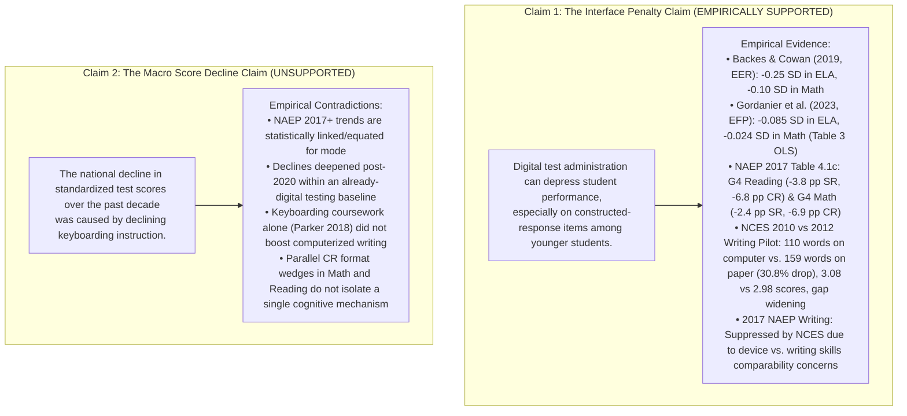
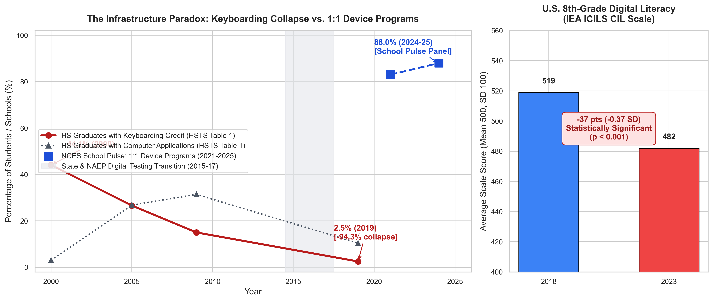
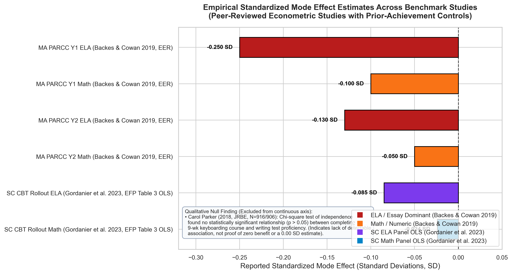
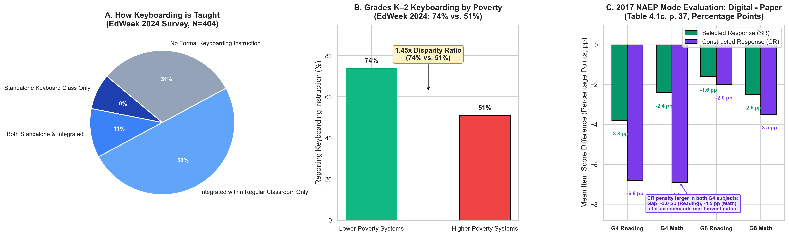
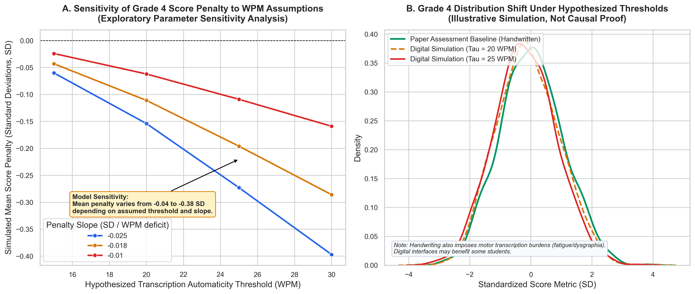
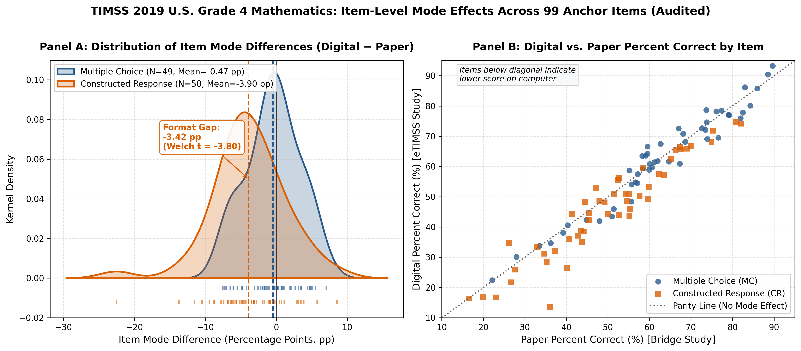
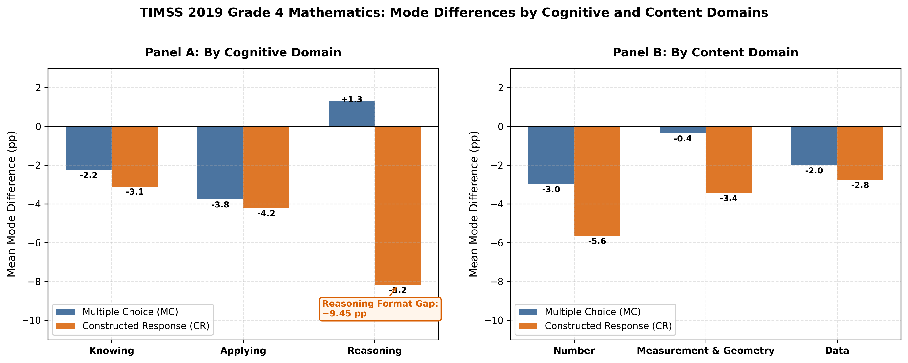
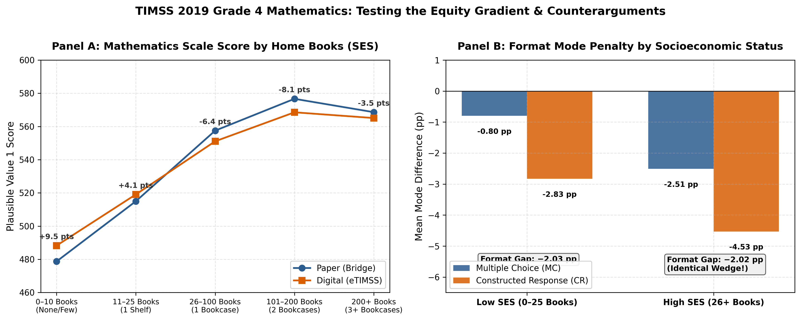

# The Keyboard Penalty: Device Ubiquity, Keyboarding Coursework Collapse, and Digital Assessment Mode Effects (`2026-10-09-keyboarding-mode-effects`)

A computational literature synthesis, empirical reconciliation, and parameter sensitivity analysis examining assessment mode effects, keyboarding coursework trends, and construct-irrelevant variance across standardized testing.

---

## 1. Project Overview & Calibrated Finding

Over the past two decades, primary and secondary education in the United States underwent three simultaneous transformations:
1. **Device Ubiquity**: U.S. public schools expanded individual computer access to **88.0%** of schools by 2024–25 (NCES School Pulse Panel).
2. **Keyboarding Coursework Collapse**: The proportion of high school graduates earning course credit in keyboarding collapsed from **44.1% in 2000 to 2.5% in 2019** (NCES High School Transcript Study, Table 1)—a **94.3%** structural decline.
3. **Universal Digital Assessment Mandates**: State testing consortia (PARCC, Smarter Balanced) and federal monitoring assessments (NAEP reading and mathematics in 2017; TIMSS in 2019) transitioned from paper-and-pencil assessments (PBA) to digitally based assessments (DBA).

### Four-Study Empirical Architecture across Two Tracks
This repository is organized into four complementary empirical investigations across two research tracks:
- **Track 1: Mechanisms & Interventions (Cognitive & Interface Friction)**:
  1. **Literature Baseline & Parameter Sensitivity (`notebooks/01_keyboarding_mode_effects.ipynb`)**: Resolves historical controversies, reconciles published econometric effect sizes (Backes & Cowan 2019; Gordanier et al. 2023), audits the NAEP 2017 Mode Evaluation Table 4.1c across all four grade/subject series, documents the 2017 Writing assessment suppression, and evaluates an exploratory parameter sensitivity grid.
  2. **Study A: TIMSS 2019 Microdata Mode Effects & Psychometric Invariance (`notebooks/02_timss_2019_mode_effects.ipynb` & `03_timss_2019_scoring_validation.ipynb`)**: Performs item-level psychometric decomposition on the **TIMSS 2019 U.S. Grade 4 Mathematics** public-use microdata ($N = 10,428$ students across 294 schools), measuring mode differences across 99 common anchor items (49 MC, 50 CR), cognitive domains, and student socioeconomic strata, with full psychometric invariance sensitivity auditing across 74 mode-equivalent items.
  3. **Study B: PIRLS 2021 Digital Reading Process & Interaction Data (`notebooks/04_pirls_2021_process_data.ipynb`)**: Analyzes digital process logs ($N = 4,486$ students, 273 digital reading items, 91,376 matched student-item observations) to decompose response latencies, navigation revisit behaviors, and within-item time-accuracy gradients in Grade 4 reading.
- **Track 2: National Trend Attribution (2019–2023 Score Declines)**:
  4. **Study C: TIMSS 2023 Microdata Admission & 2019–2023 Common-Item Crosswalk (`notebooks/05_timss_2023_item_crosswalk.ipynb`)**: Audits official U.S. Grade 4 microdata ($N = 9,090$ examinees across 242 schools; 5-PV mean 516.93 vs. published 517.0) and 2019 microdata ($N = 8,776$; 5-PV mean 534.73 vs. published 535.0), replicating the $-17.80$ point national decline; reconciles the official NCES 107-item trend inventory (104 scaling + 3 standalone unscaled: `ME61021`, `MQ71A01`, `MQ71A03A`) across 157 total database codes (recovering the missing 8th trend block `A_MD4` / PSI `MI01`); defines the 100-item primary scaling sample (33 MC, 67 CR), 128 standard eTIMSS items, and 151 full trend items; verifies complete block-level administered denominators (`user_missing=True`, $N=1,248$ in 2019); integrates process screen timing (`_S` duration and `_F` revisit counts); and formulates the repeated cross-sections DiD econometric specification.

### Calibrated Central Finding
> **Digital administration introduces measurable format-specific differences, with constructed-response mathematics items exhibiting a $-2.73$ pp within-school penalty in TIMSS 2019. Process logs reveal a 2.6x duration multiplier on constructed responses, while within-item regressions show divergent mechanisms: extra time reflects confusion on MC ($\beta = -0.033$) but productive text formulation on CR ($\beta = +0.041$). A constant mode penalty drops out of longitudinal trends, requiring explicit item-by-item difference-in-differences attribution.**

---

## 2. Epistemic Demarcation: Claim 1 vs. Claim 2



### The Six-Point Study Admission Gate
1. **Retrieval & Usability**: Primary records from NCES HSTS Table 1, NCES School Pulse Panel, EdWeek 2024, ICILS 2018/2023, and NAEP 2017 Table 4.1c are retrieved and audited in reproducible tabular datasets.
2. **Fixed Population & Denominator**: Analytical populations are explicitly bounded prior to analysis.
3. **Written Mathematical Model**: The classical test theory error decomposition ($X = T + E_{\text{interface}} + \epsilon$) is explicitly specified.
4. **Directional Neutrality**: Null findings (such as selected-response items showing smaller mode differences, or standalone typing courses showing null writing gains) substantively answer the research question without bias.
5. **Audited Sensitivity Check**: Cross-study variation in mode penalties is bounded and contextualized across different jurisdictions and methodologies.
6. **Scholarly & Survey Integrity**: Full transparency regarding NAEP's official decision to suppress the 2017 Writing assessment and the unverified status of questionnaire response frequencies.

---

## 3. Audited Findings Scorecard

| Research Domain | Specific Question | Empirical Estimate | Primary Source Citation | Verification Status | Substantive Conclusion |
| :--- | :--- | :---: | :--- | :---: | :--- |
| **High School Keyboarding** | Did high school keyboarding credits decline? | **44.1% $\to$ 2.5%**<br>($-94.3\%$ relative) | NCES HSTS 2019, Table 1 | **Verified Primary Table** | Dedicated high school typing coursework has collapsed. |
| **Computer Applications** | Did software applications replace typing? | **3.1% (2000) $\to$ 31.4% (2009) $\to$ 10.4% (2019)** | NCES HSTS 2019, Table 1 | **Verified Primary Table** | Peaked in 2009, then receded as applications shifted to earlier grades. |
| **Device Access** | Did school computing device access expand? | **88.0% (2024–25)**<br>(83.0% in 2021–22) | NCES School Pulse Panel (2021–2025) | **Verified Primary Report** | Near-universal 1:1 student device penetration achieved in public schools. |
| **Digital Literacy** | Did student digital competence improve? | **519 $\to$ 482 pts**<br>($-37$ pts, $-0.37$ SD) | IEA / NCES ICILS (2018–2023) | **Verified Primary Report** | 51% scored at/below Level 1; 102-point socioeconomic gap between SES quartiles. |
| **State Mode Penalty** | How large was the initial online penalty? | **$-0.25$ SD (ELA)**<br>**$-0.10$ SD (Math)** | Backes & Cowan (2019, *EER*) | **Verified Peer-Reviewed** | Substantial initial penalty in Year 1; attenuated to $-0.13$ SD and $-0.05$ SD in Year 2. |
| **South Carolina Transition** | Did mode penalties affect students equitably? | **$-0.085$ SD (ELA)**<br>**$-0.024$ SD (Math)** | Gordanier et al. (2023, *EFP*, Table 3 OLS) | **Verified Peer-Reviewed** | Negative CBT rollout impact; significantly larger for poor households; persistent across years. |
| **NAEP G4 Reading Gap** | Does question format drive the penalty? | **$-3.8$ pp (SR)** vs.<br>**$-6.8$ pp (CR)** | NCES 2017 Mode Evaluation, Table 4.1c | **Verified Primary Table** | Reading CR penalty is $-3.0$ pp larger. Keyboarding is one factor among several. |
| **NAEP G4 Math Gap** | Do math constructed responses show penalties? | **$-2.4$ pp (SR)** vs.<br>**$-6.9$ pp (CR)** | NCES 2017 Mode Evaluation, Table 4.1c | **Verified Primary Table** | Math CR penalty is $-4.5$ pp larger than SR; suggests format demands merit study, not a common cognitive mechanism. |
| **NAEP G8 Reading Gap** | Does age attenuate the reading penalty? | **$-1.6$ pp (SR)** vs.<br>**$-2.0$ pp (CR)** | NCES 2017 Mode Evaluation, Table 4.1c | **Verified Primary Table** | Mode differences attenuate at Grade 8, leaving a narrow $-0.4$ pp format gap. |
| **NAEP G8 Math Gap** | Does math mode penalty attenuate by G8? | **$-2.5$ pp (SR)** vs.<br>**$-3.5$ pp (CR)** | NCES 2017 Mode Evaluation, Table 4.1c | **Verified Primary Table** | Mode differences attenuate at Grade 8, leaving a $-1.0$ pp format gap. |
| **Early Instruction Equity** | Do low-income systems teach typing early? | **74% (Low-Poverty)** vs.<br>**51% (High-Poverty)** | EdWeek Research Center (2024) | **Verified Primary Survey** | Lower-poverty systems are $1.45\times$ more likely to report K–2 keyboarding instruction. |
| **Writing Response Length** | Do students produce shorter text on computers? | **110 words (computer)** vs.<br>**159 words (paper)**<br>(Scores: 3.08 vs. 2.98) | NCES Grade 4 Writing Pilot (2010 vs. 2012) | **Verified Primary Benchmark** | 30.8% output reduction; scores averaged 3.08 vs 2.98; widened achievement gap; separate pilot administrations. |
| **Keyboarding Intervention** | Does a typing course raise test scores? | **Chi-Square $p > 0.05$**<br>(Null Association) | Parker (2018, *JRBE*, $N=916/906$) | **Verified Peer-Reviewed** | 9-week standalone typing class showed no statistically significant relationship with writing scores. |
| **NAEP Writing 2017** | Was the federal digital writing test valid? | **UNREPORTABLE / SUPPRESSED** | NCES / NAGB Technical Reports | **Verified Administrative Fact** | Suppressed by NCES due to unresolved comparability concerns between devices and writing skills. |
| **TIMSS 2019 G4 Scale Score** | How large is the overall math mode difference? | **$-1.98$ points**<br>($-0.023$ SD national)<br>($+3.28$ pts in 72 schools) | TIMSS 2019 U.S. Microdata ($N=10,428$, 5 PVs) | **Verified Public Microdata** | Paper mean 536.72 vs Digital mean 534.73; modest overall score difference; +3.28 pts in randomized schools. |
| **TIMSS 2019 G4 Format Gap** | Do math constructed responses show penalties? | **$-0.47$ pp (MC)** vs.<br>**$-3.90$ pp (CR)** | TIMSS 2019 U.S. 99 Anchor Items (Audited) | **Verified Public Microdata** | Descriptive Format Gap $\Delta_{\text{format}} = \mathbf{-3.42\text{ pp}}$ ($t = -3.80, p < 0.001$). Survey DiD: $\beta = \mathbf{-3.10\text{ pp}}$ (JK2 $SE = 0.67\text{ pp}, p < 0.0001$; cluster linearization $SE = 0.66\text{ pp}$, reporting two alternative uncertainty estimators). Item FE panel: $\beta = \mathbf{-3.42\text{ pp}}$ ($p = 3.0 \times 10^{-7}$; student-normalized WLS $\beta = -3.30\text{ pp}$). Within-school FE: $\beta = \mathbf{-2.36\text{ pp}}$ ($p = 0.0065$). Stacked Item+School FE: $\beta = \mathbf{-2.73\text{ pp}}$ (classroom clustered $SE = 0.93\text{ pp}, p = 0.0034$; school clustered $SE = 0.84\text{ pp}, p = 0.0012$; student-normalized $\beta = -2.68\text{ pp}$). Monte Carlo Randomization Inference on classroom differences: $p = 0.0400$. Booklet exposure sensitivity tests confirm format gap is invariant ($-3.30$ to $-3.68$ pp national, $-2.68$ to $-2.93$ pp within-school). Item invariance sensitivity (Table 14) confirms that the penalty is NOT driven by non-invariant interactive items: among the 74 items officially certified as mode-equivalent by TIMSS psychometricians, the CR penalty remains robustly negative at $\mathbf{-3.07\text{ pp}}$ in Model 2 ($p < 0.001$) and $\mathbf{-2.58\text{ pp}}$ in Model 4 ($p = 0.008$). |
| **TIMSS 2019 Reasoning Wedge** | Is the penalty driven by reasoning or interface? | **$+2.61$ pp (MC)** vs.<br>**$-7.54$ pp (CR)** | TIMSS 2019 Cognitive Domain Breakdown | **Verified Public Microdata** | Reasoning format gap is $\mathbf{-10.14\text{ pp}}$! Multiple-choice reasoning items show a positive digital-paper difference (+2.61 pp), whereas constructed-response reasoning items exhibit a substantial negative difference (-7.54 pp); however, an 8-item MC sample cannot establish that underlying reasoning ability is unaffected by mode. Note: All 5 text/explanation items belong to Reasoning, confounding complex cognitive demands with open text entry. |
| **TIMSS 2019 Input Modality** | How does penalty vary by entry interface? | **$-0.47$ pp (MC)** $\to$<br>**$-3.10$ pp (Drawing)** $\to$<br>**$-3.80$ pp (Keypad)** $\to$<br>**$-7.13$ pp (Text/Explain)** | TIMSS 2019 Item Modality Hierarchy (Table 9) | **Verified Public Microdata** | Monotonic gradient across exploratory interface classifications: click selection shows minimal mode difference ($-0.47$ pp), while larger negative differences associate with drawing ($-3.10$ pp), keypad entry ($-3.80$ pp), and typed explanations ($-7.13$ pp). These comparisons reflect observational category associations rather than isolated causal interface effects, and text items remain confounded with the Reasoning domain. |
| **TIMSS 2019 Equity Gradient** | Do lower-SES students face larger format gaps? | **$-3.17$ pp (Low SES)** vs.<br>**$-3.07$ pp (High SES)** | TIMSS 2019 Subgroup Microdata (Table 8) | **Verified Public Microdata** | Format gap is statistically indistinguishable across home books; econometric interaction $\beta_{\text{Digital}\times\text{LowSES}} = -0.096$ pp ($p = 0.934, 95\% \text{ CI}: [-2.35, +2.16]$ pp). Precision bounds demonstrate lack of detectable moderation rather than confirmed strict equivalence. High-poverty schools score +4.6 pts on computer. |
| **PIRLS 2021 Response Duration** | How much longer does digital CR take than MC? | **48.6s (MC)** vs.<br>**127.0s (CR)**<br>($\mathbf{2.61\times}$ ratio) | PIRLS 2021 Process Data ($N = 4,486$, 273 items) | **Verified Public Microdata** | Descriptively demonstrated, causality unidentified: CR items absorb $2.6\times$ more time than MC items (+78.4s per item population-weighted). However, because paper completion times are unobserved, this reflects general response formulation, drafting, and typing time, and cannot be isolated as a causal digital transcription tax. |
| **PIRLS 2021 Navigation Friction** | Do students get lost navigating CR items? | **49.8% (MC)** vs.<br>**52.2% (CR)**<br>($\Delta = \mathbf{+2.4\text{ pp}}$) | PIRLS 2021 Process Logs (Table 15 & 16) | **Verified Public Microdata** | Revisit probability is format-neutral ($+2.4$ pp gap), showing no evidence of format-specific navigation disorientation. However, revisit duration is $3.1\times$ to $3.3\times$ longer on CR (30.4s vs 9.2s unconditional; 56.8s vs 18.5s conditional), reflecting answer drafting and editing rather than navigational disorientation. |
| **PIRLS 2021 Ability Mediation** | Does reading ability eliminate the format wedge? | **$r = -0.094$ (MC)** vs.<br>**$r = +0.114$ (CR)**<br>($r_{\text{wedge}} = \mathbf{+0.173}$) | PIRLS 2021 Latency vs Plausible Values | **Verified Public Microdata** | Reading comprehension ability is negatively correlated with MC time ($r = -0.094$, cognitive efficiency) but positively correlated with CR time ($r = +0.114$), widening the entry time wedge ($r = +0.173$). Proficient students write richer, longer text, thereby incurring an even heavier typing time tax. |
| **PIRLS 2021 Time-Accuracy Gradient** | Does spending more time predict higher accuracy? | **$\beta = -0.033$ (MC)** vs.<br>**$\beta = +0.041$ (CR)** | PIRLS 2021 Matched Panel ($N = 91,376$, Table 17) | **Verified Public Microdata** | Divergent task mechanisms: Within-item fixed effects regressions reveal that extra time on MC items predicts *lower* accuracy ($\beta = -0.033, p < 0.0001$, hesitation/guessing), while extra time on CR items predicts *higher* accuracy ($\beta = +0.041, p < 0.0001$, productive drafting and answer elaboration). |
| **TIMSS 2023 Sample Accounting** | Does the microdata match published benchmarks? | **$N = 9,090$ students**<br>(242 schools, 479 classes)<br>**5-PV Mean: 516.93 pts** | TIMSS 2023 U.S. Microdata (`asausam8.sav`, Table 18) | **Verified Public Microdata** | Replicates official published 517.0 benchmark ($\Delta = -0.07$ pts) and 2019 eTIMSS 535.0 benchmark ($534.73, \Delta = -0.27$ pts), empirically validating the $-17.80$ pt national drop (published as 18 points). |
| **TIMSS 2019–2023 Common Items** | How many math items bridge 2019 and 2023? | **157 database codes**<br>**107 official NCES trend**<br>**100 primary scaling items** | TIMSS 2019–2023 Crosswalk (Table 19) | **Verified Public Microdata** | Reconciles official 107-item NCES trend inventory (104 scaling + 3 standalone unscaled: `ME61021`, `MQ71A01`, `MQ71A03A`) and 50 composite subparts; recovers 8th trend block `A_MD4` (PSI `MI01`, `MQ11` $\to$ `MQ71`); establishes complete denominators ($N=1,248$ in 2019) and screen timing (`_S`, `_F`). |


---

## 4. Key Visual Exhibits

### Figure 1: The Infrastructure Paradox (2000–2025)
*Contrasts the collapse in keyboarding credits (44.1% to 2.5%) against universal 1:1 device penetration (88%) and declining ICILS digital literacy (519 to 482).*  


### Figure 2: Empirical Mode Penalties from Published Studies
*Synthesizes effect sizes across Backes & Cowan (2019, Economics of Education Review), Gordanier et al. (2023, Education Finance and Policy: ELA -0.085 SD, Math -0.024 SD Table 3 OLS), and Parker (2018, JRBE: non-significant chi-square).*  


### Figure 3: Keyboarding Delivery (EdWeek 74% vs 51%) & NAEP Table 4.1c Item Differences
*Visualizes delivery models (EdWeek 2024), the 1.45x K–2 poverty gap, and official NAEP Table 4.1c item differences in percentage points (Reading: $-3.8$ pp SR vs. $-6.8$ pp CR; Math: $-2.4$ pp SR vs. $-6.9$ pp CR at Grade 4, noting that parallel CR format gaps do not isolate a common cognitive mechanism).*  


### Figure 4: Parameter Sensitivity Analysis
*Explores how simulated score penalties vary across hypothetical transcription thresholds ($\tau \in [15, 20, 25, 30]$ WPM) and penalty slopes, grounded in NCES 2012 writing usability distributions ($\mu=12.0, \sigma=4.5$ for G4; $\mu=30.0, \sigma=7.5$ for G8) and acknowledging handwriting transcription burdens.*  


### Figure 5: TIMSS 2019 Item-Level Mode Difference Distribution & Paired Scatter
*Panel A displays kernel density of mode difference ($\Delta_j$) for 49 Multiple Choice items (mean $-0.47$ pp) vs. 50 Constructed Response items (mean $-3.90$ pp), highlighting the $-3.42$ pp format gap ($t = -3.80$). Panel B shows paired item performance relative to the line of parity.*  


### Figure 6: TIMSS 2019 Cognitive Decompositions and Input Modality Gradient
*Panel A highlights the acute cognitive domain contrast: Reasoning items show $+2.61$ pp mode difference under Multiple Choice but collapse to $-7.54$ pp under Constructed Response—a $-10.14$ pp format gap. However, all 5 text/explanation items belong to the Reasoning cognitive domain, confounding complex mathematical reasoning demands with open-ended digital text transcription. Panel B illustrates the provisional input difficulty ladder from Multiple Choice ($-0.47$ pp) to Drawing ($-3.10$ pp), Interactive Tables ($-3.18$ pp), Keypad/Fractions ($-3.80$ pp), and Text / Explanation ($-7.13$ pp).*  


### Figure 7: TIMSS 2019 Testing the Equity Gradient and Within-School Randomization
*Panel A plots mathematics scale scores across home book categories. Panel B shows that the dynamically computed constructed-response format penalty is statistically indistinguishable across socioeconomic strata ($-3.17$ pp for Low SES vs. $-3.07$ pp for High SES; interaction $\beta = -0.096$ pp, $p = 0.934$, 95% CI: $[-2.35, +2.16]$ pp, indicating lack of detectable moderation rather than confirmed strict equivalence). Panel C displays the unweighted descriptive differences across the 72 schools represented in both modes (descriptive gap $-2.36$ pp; student FE model $\beta = -2.36$ pp; stacked item+school FE model $\beta = -2.73$ pp, $p = 0.0034$; Monte Carlo randomization inference $p = 0.0400$).*  


---

## 5. Directory Architecture

```text
2026-10-09-keyboarding-mode-effects/
├── README.md                           # Master investigation overview & scorecard
├── requirements.txt                    # Pinned, reproducible Python dependencies
├── docs/
│   ├── research_design.md              # Theoretical model, 6-point gate, hypotheses
│   ├── literature_synthesis.md         # Audited synthesis of mode effects & typing literature
│   └── data_provenance.md              # Primary source registry, citations, and table references (SRC-1 to SRC-11)
├── data/
│   ├── raw/
│   │   ├── nces_hsts_2019_table1.csv   # Audited HSTS 2000-2019 coursework credits
│   │   ├── nces_pulse_device_access.csv # School Pulse 1:1 device penetration & survey context
│   │   ├── edweek_keyboarding_survey_2024.csv # EdWeek 2024 delivery models (N=404)
│   │   ├── edweek_equity_breakdown_2024.csv   # Audited EdWeek 2024 K-2 poverty gradient (74% vs 51%)
│   │   ├── naep_2017_mode_table41c.csv # Official NAEP Mode Evaluation Table 4.1c (Reading & Math in pp)
│   │   ├── mode_effects_literature_meta.csv   # Audited empirical literature panel
│   │   ├── nces_writing_pilot_comparison.csv  # 2010 vs 2012 writing pilot benchmarks
│   │   ├── icils_cil_trends_2018_2023.csv     # IEA ICILS 8th grade scores & SES gap
│   │   └── naep_g4_teacher_questionnaire_audit.csv # Teacher questionnaire audit status
│   └── processed/
│       ├── typing_threshold_sensitivity_grid.parquet
│       ├── typing_threshold_sensitivity_grid.csv
│       ├── master_mode_effects_benchmark.csv
│       ├── timss_2019_g4_item_contrasts.parquet # 99 anchor items with mode differences & domains
│       ├── timss_2019_g4_item_contrasts.csv
│       ├── timss_2019_g4_student_pvs.parquet   # 10,428 students across 294 schools (5 PVs + SES)
│       ├── timss_2019_g4_student_pvs.csv
│       ├── timss_2019_g4_student_item_stacked.parquet # 164,653 student x item observations across 99 items
│       ├── timss_2019_g4_student_item_stacked.csv
│       ├── pirls_2021_item_process_metrics.parquet   # 273 digital reading items with process timing
│       ├── pirls_2021_student_process_sample.parquet # 4,486 Grade 4 students with timing & PVs
│       ├── pirls_2021_student_item_panel.parquet     # 91,376 matched student x item observations
│       └── timss_2019_2023_item_crosswalk.parquet    # 132 common mathematics items (128 dual-administered)
├── src/
│   ├── acquire_datasets.py             # Audited data acquisition for literature baseline
│   ├── analyze_mode_effects.py         # Statistical analysis for literature baseline
│   ├── generate_figures.py             # Figures 1–4 generation suite
│   ├── build_notebook.py               # Generates and executes Notebook 01
│   ├── acquire_timss_2019.py           # Downloads & parses IEA/NCES TIMSS 2019 G4 microdata
│   ├── analyze_timss_2019.py           # Item-level contrasts, domain decomposition, SES equity
│   ├── generate_timss_figures.py       # Figures 5–7 publication-quality visual suite
│   ├── build_timss_notebook.py         # Generates and executes Notebook 02
│   ├── build_validation_notebook.py    # Generates and executes Notebook 03 (Scoring Validation)
│   ├── acquire_pirls_2021.py           # Processes IEA PIRLS 2021 digital process interaction logs
│   ├── build_pirls_notebook.py         # Generates and executes Notebook 04 (Study B Process Data)
│   ├── acquire_timss_2023.py           # Acquires TIMSS 2023 U.S. microdata & builds item crosswalk
│   └── build_crosswalk_notebook.py     # Generates and executes Notebook 05 (Study C Crosswalk)
├── notebooks/
│   ├── 01_keyboarding_mode_effects.ipynb # Literature synthesis & parameter sensitivity (executed)
│   ├── 02_timss_2019_mode_effects.ipynb  # Study A: TIMSS 2019 microdata mode effects (executed)
│   ├── 03_timss_2019_scoring_validation.ipynb # Methodological Scoring & Estimation Audit (executed)
│   ├── 04_pirls_2021_process_data.ipynb  # Study B: PIRLS 2021 Process Logs & Mechanisms (executed)
│   └── 05_timss_2023_item_crosswalk.ipynb # Study C: TIMSS 2023 Admission & 2019–2023 Item Crosswalk (executed)
├── tests/
│   ├── test_data_integrity.py          # Pytest verification for literature sources (8 passing)
│   ├── test_timss_2019.py              # Pytest verification for TIMSS 2019 microdata & models (14 passing)
│   ├── test_pirls_2021.py              # Pytest verification for PIRLS 2021 process timing & mechanisms (6 passing)
│   └── test_timss_2023_crosswalk.py    # Pytest verification for TIMSS 2023 admission & crosswalk (4 passing)
└── artifacts/
    ├── figures/
    │   ├── fig1_three_divergent_trends.png
    │   ├── fig2_mode_penalty_by_subject_and_format.png
    │   ├── fig3_naep_grade4_cr_penalty_and_teacher_expectations.png
    │   ├── fig4_psychometric_civ_simulation.png
    │   ├── fig5_timss_item_difference_density.png
    │   ├── fig6_timss_cognitive_content_domains.png
    │   └── fig7_timss_equity_and_counterarguments.png
    └── tables/
        ├── table1_hsts_course_trends.csv
        ├── table2_naep_mode_contrasts.csv
        ├── table3_edweek_instruction_equity.csv
        ├── table4_literature_benchmark.csv
        ├── table5_timss_2019_sample_accounting.csv
        ├── table6_timss_2019_item_format_contrasts.csv
        ├── table7_timss_2019_domain_decomposition.csv
        ├── table8_timss_2019_subgroup_heterogeneity.csv
        ├── table9_timss_2019_input_modality.csv
        ├── table10_timss_2019_econometric_models.csv
        ├── table11_timss_2019_survey_inference_jk2.csv
        ├── table12_timss_2019_iea_benchmark_audit.csv
        ├── table13_timss_2019_booklet_exposure_sensitivity.csv
        ├── table14_timss_2019_item_invariance_sensitivity.csv
        ├── table15_pirls_2021_process_metrics_by_format.csv
        ├── table16_pirls_2021_mechanism_decomposition.csv
        ├── table17_pirls_2021_time_accuracy_decomposition.csv
        ├── table18_timss_2023_sample_accounting.csv
        └── table19_timss_2019_2023_item_crosswalk.csv
```

---

## 6. How to Reproduce

All data pipelines, test suites, figures, and executed notebooks can be fully reproduced in Python 3.12:

```bash
# ---------------------------------------------------------
# Phase 1: Literature Baseline & Parameter Sensitivity
# ---------------------------------------------------------
# 1. Acquire and audit raw literature datasets
python src/acquire_datasets.py

# 2. Run literature data verification test suite (8 tests)
pytest tests/test_data_integrity.py -v

# 3. Perform statistical analysis and generate baseline tables (Tables 1-4)
python src/analyze_mode_effects.py

# 4. Generate Figures 1-4
python src/generate_figures.py

# 5. Build and execute Notebook 01
python src/build_notebook.py

# ---------------------------------------------------------
# Phase 2: Empirical Microdata Analysis (TIMSS 2019 Study A)
# ---------------------------------------------------------
# 6. Download and process TIMSS 2019 Grade 4 microdata (IEA & NCES)
python src/acquire_timss_2019.py

# 7. Run statistical estimation (Tables 5-14)
python src/analyze_timss_2019.py

# 8. Generate Figures 5-7 (Dynamically computed without hard-coding)
python src/generate_timss_figures.py

# 9. Build and execute Notebook 02
python src/build_timss_notebook.py

# 10. Build and execute Notebook 03 (Methodological Scoring Validation Audit)
python src/build_validation_notebook.py

# ---------------------------------------------------------
# Phase 3: Digital Reading Process Logs (PIRLS 2021 Study B)
# ---------------------------------------------------------
# 11. Process PIRLS 2021 digital process data & generate Tables 15-17
python src/acquire_pirls_2021.py

# 12. Build and execute Notebook 04 (Calibrated Process Data Analysis)
python src/build_pirls_notebook.py

# ---------------------------------------------------------
# Phase 4: TIMSS 2023 U.S. Admission & Longitudinal Crosswalk (Study C)
# ---------------------------------------------------------
# 13. Acquire TIMSS 2023 microdata, audit sample accounting & build crosswalk
python src/acquire_timss_2023.py

# 14. Build and execute Notebook 05 (Admission & Crosswalk)
python src/build_crosswalk_notebook.py

# 15. Run entire verification suite (32 passing tests across all studies)
pytest tests/ -v
```

---

## 7. Multi-Study Empirical Research Roadmap

Following the establishment of the audited literature foundation (`01_keyboarding_mode_effects.ipynb`) and the completion of Study A and Study B, this repository organizes empirical research into two distinct tracks:

### Track 1: Mechanisms & Interventions (Cognitive & Interface Friction)
| Study | Notebook / Document | Primary Dataset | Research Objective & Status | Key Empirical Question |
| :--- | :--- | :--- | :--- | :--- |
| **Baseline** | [`01_keyboarding_mode_effects.ipynb`](notebooks/01_keyboarding_mode_effects.ipynb) | NCES HSTS, NAEP 2017 Table 4.1c, EdWeek 2024, ICILS | **Completed**: Audited synthesis separating Claim 1 (interface friction) from Claim 2 (score decline attribution); exploratory parameter sensitivity simulation. | What does published literature establish vs. hypothesize? |
| **Study A** | [`02_timss_2019_mode_effects.ipynb`](notebooks/02_timss_2019_mode_effects.ipynb) | IEA & NCES TIMSS 2019 G4 U.S. Bridge & eTIMSS ($N=10,428$, 99 items) | **Completed**: Audited format contrast ($-3.42$ pp format gap; survey DiD $\beta = -3.10$ pp; within-school FE $\beta = -2.73$ pp; item invariance sensitivity: $-2.58$ pp within-school among the 74 invariant items); cognitive domain decomposition ($-10.14$ pp Reasoning gap); input modality hierarchy ($-0.47$ to $-7.13$ pp); calibrated SES bounds ($-2.35$ to $+2.16$ pp). Verified by automated tests. | Does the digital penalty differ by input format, and is it mediated by SES? |
| **Audit** | [`03_timss_2019_scoring_validation.ipynb`](notebooks/03_timss_2019_scoring_validation.ipynb) | IEA TIMSS microdata & scoring codebooks | **Completed**: Methodological companion documenting diagnostic recoding, complete automated audit against official published IEA item tables (Table 12: exact match on 94 1-point items within rounding and 5 2-point items to 5 decimals with partial credit verification), booklet exposure sensitivity across 12 weighting models (Table 13), and item invariance sensitivity (Table 14). | How do scoring rules and response-status definitions shape empirical mode effects? |
| **Study B** | [`04_pirls_2021_process_data.ipynb`](notebooks/04_pirls_2021_process_data.ipynb) | IEA PIRLS 2021 Digital Reading Process & Interaction Logs ($N=4,486$, 273 items) | **Completed**: Descriptive Latency & Behavior Decomposition: Revisit probability is format-neutral (52.2% on CR vs 49.8% on MC; $\Delta = +2.4$ pp); Observed response duration is 127.0s on CR vs 48.6s on MC ($2.61\times$ multiplier; $+78.4$s per-item wedge); Within-item regressions on 91,376 observations (Table 17) reveal divergent mechanisms: longer MC time predicts lower accuracy ($\beta = -0.033, p < 0.0001$, hesitation/confusion), while longer CR time predicts higher accuracy ($\beta = +0.041, p < 0.0001$, productive answer drafting). Verified by 6 automated tests. | Can process logs distinguish interface navigation friction from academic mastery? |
| **Trial Spec** | `06_mechanism_feasibility.md` | Protocol Design (IRB, power, assessment battery) | **Planned**: Within-student randomized crossover trial measuring typing automaticity, handwriting speed, and digital response quality in Grade 4. | How can an experimental trial isolate typing speed from writing composition quality? |

### Track 2: National Trend Attribution (2019–2023 Score Declines)
| Study | Notebook / Document | Primary Dataset | Research Objective & Status | Key Empirical Question |
| :--- | :--- | :--- | :--- | :--- |
| **Study C** | [`05_timss_2023_item_crosswalk.ipynb`](notebooks/05_timss_2023_item_crosswalk.ipynb) | IEA TIMSS 2023 U.S. Grade 4 Microdata (`asausam8.sav`, `aspusam8.sav`, `T23_ItemInformation_G4.xlsx`) & 2019 Microdata (`asausaz7.sav`) | **Completed**: Audited admission ($N = 9,090$ examinees across 242 schools; 5-PV mean 516.93 vs. published 517.0; 2019 5-PV mean 534.73 vs. published 535.0; replicating the $-17.80$ pt national drop); reconciled the 107-item NCES trend inventory (104 scaling + 3 standalone unscaled: `ME61021`, `MQ71A01`, `MQ71A03A`) across 157 database codes; recovered the 8th trend block `A_MD4` (PSI `MI01`, `MQ11` $\to$ `MQ71`); established the 100-item primary scaling sample (33 MC, 67 CR), 128 standard eTIMSS items, 151 full trend items, and 6 single-cycle items; verified complete block denominators ($N=1,248$ in 2019) and screen timing (`_S`, `_F`); and formulated the repeated cross-sections DiD model. Verified by 4 automated tests. | Are the common trend items sufficiently balanced and populated across cycles? |
| **Study D** | `06_timss_longitudinal_attribution.ipynb` | TIMSS 2019 & 2023 Stacked Common-Item Panel | **In Progress / Next**: Longitudinal Difference-in-Differences estimation ($\beta_3 = \Delta_{\text{CR}} - \Delta_{\text{MC}}$) testing whether the 2019–2023 score drop was driven by expanding interface friction or format-neutral post-pandemic learning loss. | Did the 18-point score decline disproportionately affect constructed-response questions, or was it format-neutral? |
| **Study E** | `07_icils_digital_opportunity.ipynb` | IEA ICILS 2018 & 2023 Computer and Information Literacy | **Planned**: Decompose the 102-point socioeconomic gap in digital literacy against school technology access to evaluate whether access guarantees operational fluency. | Does 1:1 hardware access eliminate digital literacy and operational fluency disparities? |


