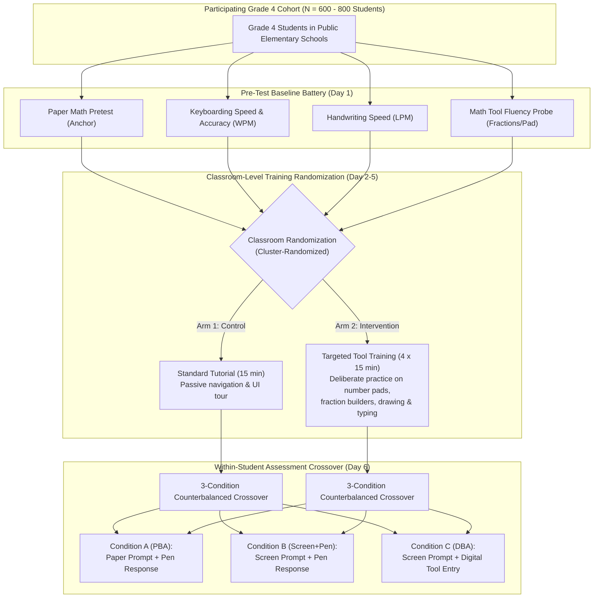
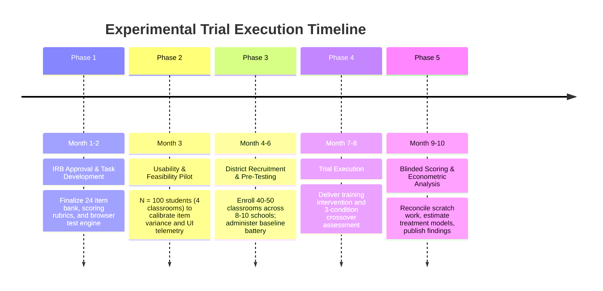

# Experimental Protocol & Randomized Field Trial Design: Decomposing Digital Mathematics Mode Effects and Interface Interventions

**Document**: `docs/experimental_design_protocol.md`  
**Author**: Computational Sketchbook Observatory  
**Date**: October 2026  
**Status**: Pre-Trial Specification & Research Protocol  

---

## 1. Executive Summary & Epistemic Motivation

Observational analyses of public-use national assessments (such as TIMSS 2019, TIMSS 2023, and NAEP 2017) consistently reveal that elementary students face a disproportionate performance penalty on digitally administered **constructed-response (CR)** mathematics items ($-2.73$ pp within schools in TIMSS 2019). Furthermore, process logs (PIRLS 2021) demonstrate that constructed responses absorb $2.6\times$ longer duration and exhibit divergent time-accuracy mechanisms ($\beta = -0.033$ on MC vs. $\beta = +0.041$ on CR).

However, observational data alone face three insurmountable identification boundaries:
1. **The Presentation vs. Entry Confound**: In standard digital assessments, switching from paper to digital changes **both** the presentation medium (reading prompts on a screen) and the response entry medium (typing or using onscreen tools).
2. **The Transcription vs. Cognitive Demand Confound**: Items requiring written explanations often involve higher-order mathematical reasoning, confounding complex cognitive demands with keyboarding friction.
3. **The Unobserved Counterfactual of Training**: Observational datasets cannot determine whether the format penalty is remediable through deliberate interface practice or represents an intrinsic cognitive bottleneck of digital testing.

To definitively resolve these mechanisms, this protocol specifies a **two-tier experimental investigation**:
- **A Within-Student Response-Mode Crossover**: Disentangling screen reading from digital response entry.
- **A Between-Classroom Randomized Interface Training Intervention**: Testing whether targeted mathematical tool familiarization eliminates or attenuates the digital response penalty.

---

## 2. Factorial Experimental Architecture

---

## 3. The Three Assessment Conditions & Causal Contrasts

Each student completes three balanced blocks of fourth-grade mathematics tasks under three distinct presentation and response modes:

| Condition | Prompt Presentation | Response Entry Method | Operational Meaning |
| :--- | :--- | :--- | :--- |
| **Condition A (Paper Baseline)** | Printed Paper Booklet | Handwritten on Paper | Traditional paper-and-pencil assessment (PBA). |
| **Condition B (Screen + Pen)** | Digital Screen Display | Handwritten on Physical Paper | Isolates the **presentation effect** (screen reading, scrolling, diagram legibility). |
| **Condition C (Full Digital)** | Digital Screen Display | Digital Interface (Keyboard, Touch/Mouse, Toolbars) | Standard digitally based assessment (DBA). |

### Formal Potential Outcomes & Estimands
Let $Y_{ij}(m, t)$ denote the score of student $i$ on item $j$ under assessment mode $m \in \{A, B, C\}$ and training condition $t \in \{0, 1\}$.

1. **Screen Presentation Effect**:
   $$\tau_{\text{presentation}} = E[Y_i(B, 0) - Y_i(A, 0)]$$
   *Estimates the net score penalty of reading mathematics tasks on screens while holding handwriting response constant.*
2. **Digital Response-Entry Effect**:
   $$\tau_{\text{entry}} = E[Y_i(C, 0) - Y_i(B, 0)]$$
   *Isolates the specific friction introduced by entering mathematical answers via digital tools (keyboarding, equation builders, on-screen drawing).*
3. **Total Digital Mode Effect**:
   $$\tau_{\text{total}} = E[Y_i(C, 0) - Y_i(A, 0)] = \tau_{\text{presentation}} + \tau_{\text{entry}}$$
4. **Training Remediation Effect on Entry Friction**:
   $$\boxed{\tau_{\text{training\_entry}} = E\big[(Y_i(C, 1) - Y_i(B, 1)) - (Y_i(C, 0) - Y_i(B, 0))\big]}$$
   *Measures whether targeted tool practice eliminates or narrows the digital-entry disadvantage.*

---

## 4. Assessment Item Banking & Task Modality Architecture

To avoid confounding item content with administration mode, we establish an item bank of **24–30 fourth-grade mathematics tasks** stratified into three distinct input families:

| Item Family | Mathematical Content | Required Interface Behavior | Typical Scoring Rubric |
| :--- | :--- | :--- | :--- |
| **Family 1: Numeric & Fraction Entry** | Whole number arithmetic, fractions, decimals, unit conversions | Number pad clicks, keyboard entry, fraction template builder | 0 / 1 binary credit |
| **Family 2: Spatial & Geometric Manipulation** | Coordinate plotting, line symmetry, angle classification, area modeling | Point-and-click plotting, drag-and-drop shapes, on-screen ruler/protractor | 0 / 1 / 2 partial credit |
| **Family 3: Written Reasoning & Explanation** | Multi-step problem solving, error analysis, justification of answers | Textbox typing (words + arithmetic expressions) | 0 / 1 / 2 rubric (mathematical logic vs. grammar) |

### Counterbalancing & Latin Square Design
To prevent learning, fatigue, or memory effects from confounding mode differences:
- No student sees the same item twice.
- Items are grouped into three parallel 8-item blocks ($B_1, B_2, B_3$) matched on difficulty, content domain, and item family.
- Blocks and conditions are rotated using a **$3 \times 3$ Latin Square**:
  - Sequence 1: Mode A ($B_1$) $\to$ Mode B ($B_2$) $\to$ Mode C ($B_3$)
  - Sequence 2: Mode B ($B_2$) $\to$ Mode C ($B_3$) $\to$ Mode A ($B_1$)
  - Sequence 3: Mode C ($B_3$) $\to$ Mode A ($B_1$) $\to$ Mode B ($B_2$)

---

## 5. Baseline Measurement Battery (Pre-Randomization Covariates)

Prior to classroom randomization, all participating students complete a standardized baseline diagnostic battery to measure baseline transcription and cognitive fluencies:

1. **Mathematics Proficiency Baseline (20 min)**: A 15-item balanced paper test measuring Grade 4 math achievement.
2. **Keyboarding Automaticity Probe (5 min)**:
   - Measured via standard copy-typing task of Grade 4 appropriate text.
   - Metrics: Net Words Per Minute ($\text{WPM} = \frac{\text{Chars}}{5} - \text{Errors}$), Raw WPM, Character Error Rate.
3. **Handwriting Automaticity Probe (3 min)**:
   - Standard alphabet and sentence copy task (Berninger et al. protocol).
   - Metric: Letters Per Minute (LPM).
4. **Mathematical Tool Fluency Probe (7 min)**:
   - Rapid entry task testing specialized digital tools: entering 5 fractions, drawing a triangle, and plotting 3 points.
   - Metric: Latency to correct tool submission.
5. **Prior Device & Testing History Survey (5 min)**:
   - Self-reported frequency of laptop/tablet use at school and home, and prior standardized testing experience.

---

## 6. Econometric & Statistical Estimation Models

For student $i$ in classroom $c$ responding to item $j$ in position/order $k$:

$$Y_{icjk} = \alpha_i + \delta_j + \beta_B B_{icjk} + \beta_C C_{icjk} + \rho_B (B_{icjk} \times T_c) + \rho_C (C_{icjk} \times T_c) + \sum_{p=1}^3 \lambda_p \text{Order}_{icjk}^p + \epsilon_{icjk}$$

where:
- $\alpha_i$ is a **student fixed effect** (or random intercept $\alpha_i \sim \mathcal{N}(0, \sigma_\alpha^2)$ in hierarchical linear modeling).
- $\delta_j$ is an **item fixed effect** (controlling for item baseline difficulty).
- $B_{icjk}$ is an indicator for Condition B (Screen + Pen).
- $C_{icjk}$ is an indicator for Condition C (Full Digital).
- $T_c \in \{0, 1\}$ indicates classroom assignment to targeted interface training.
- $\beta_B$ is the baseline **presentation effect** for control students.
- $\beta_C - \beta_B$ is the baseline **digital-entry effect** for control students.
- The training treatment interaction on entry friction is:
  $$\boxed{\tau_{\text{practice}} = \rho_C - \rho_B}$$
- Standard errors are clustered at the **classroom level** ($c$).

---

## 7. Power Calculations & Sample Size Blueprint

### Power for Within-Student Mode Contrasts ($C$ vs. $B$ or $C$ vs. $A$)
Assuming a paired within-student difference standard deviation of $\sigma_{\Delta} = 0.30$ on a $0–1$ score metric, with $\alpha = 0.05$ (two-sided) and power $1 - \beta = 0.80$:

| Total Students ($N$) | Minimum Detectable Effect Size (MDES in pp) | Minimum Detectable SD ($d$) | Suitability |
| :---: | :---: | :---: | :--- |
| **150** | $6.9$ percentage points | $0.23$ SD | Exploratory feasibility pilot only. |
| **300** | $4.8$ percentage points | $0.16$ SD | Powered for large format effects. |
| **500** | $3.8$ percentage points | $0.13$ SD | Adequately powered for primary mode difference. |
| **800** | $3.0$ percentage points | $0.10$ SD | Confirmatory trial detecting subtle $\approx 3$ pp penalties. |

### Power for Cluster-Randomized Classroom Training Intervention
Assuming an intraclass correlation coefficient $\text{ICC} = 0.05$ across classrooms of 25 students, with $\alpha = 0.05$ and $80\%$ power:

| Classrooms ($K$) | Total Students ($N$) | Design Effect ($1 + (m-1)\rho$) | MDES on Training Interaction ($\tau$) |
| :---: | :---: | :---: | :---: |
| **20 classrooms** | 500 students | $2.20$ | $0.37$ SD ($\approx 11.1$ pp) |
| **36 classrooms** | 900 students | $2.20$ | $0.28$ SD ($\approx 8.4$ pp) |
| **60 classrooms** | 1,500 students | $2.20$ | $0.21$ SD ($\approx 6.3$ pp) |

> [!IMPORTANT]
> The power analysis reveals an essential structural asymmetry: **within-student mode contrasts** require only 500–800 students to detect a 3–4 pp effect, whereas the **cluster-randomized training intervention** requires at least 36–60 classrooms to reliably detect an 8 pp moderation effect.

---

## 8. Threat Mitigations & Experimental Safeguards

1. **Scratch-Paper Preservation & Strategic vs. Operational Error Coding**:
   - In Condition C (Full Digital), students are provided physical scratch paper. Scratch paper is collected, scanned, and linked to student logs.
   - Dual-coding protocol: If a student's scratch paper contains a mathematically correct solution, but the final digital entry is incorrect or missing, this is coded as an **operational entry failure** rather than a mathematical failure.
2. **Blinded Scoring on Subjective Explanations**:
   - Written responses from Condition A, B, and C are transcribed into a standardized typographic format (or scanned with student/condition identifiers stripped) so human raters cannot infer whether an answer was typed or handwritten.
3. **Carryover and Fatigue Controls**:
   - Counterbalanced Latin square sequences with mandatory 5-minute cognitive rest intervals between 20-minute test blocks.
4. **Device Standardization**:
   - All digital testing conducted on identical 11.6-inch to 13.3-inch Chromebooks or laptops with external physical keyboards and trackpads/mice to eliminate form-factor heterogeneity.

---

## 9. Phased Execution Roadmap

